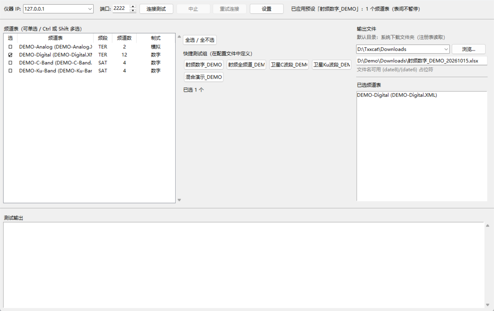
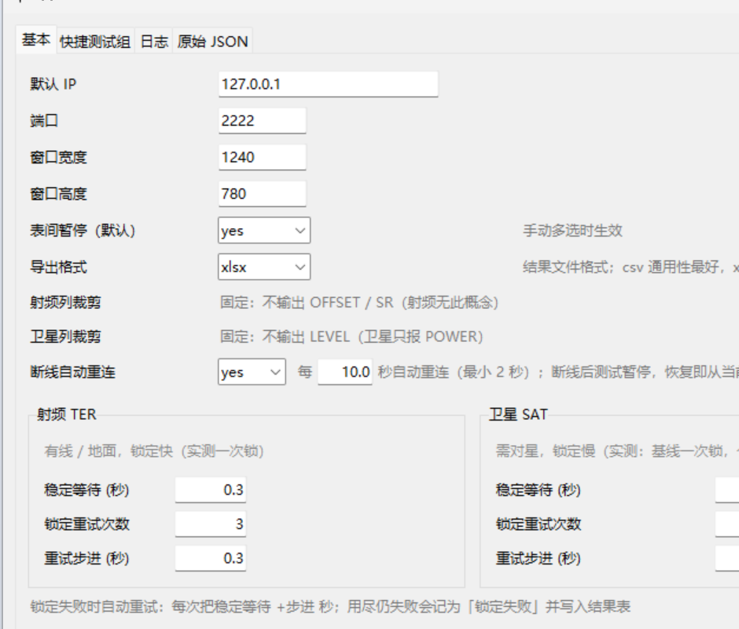

# pmcontorl — PROMAX RANGERNeo 4 频道表批量测试工具

通过 **Telnet** 远程控制 PROMAX 场强仪，对仪器里的**频道表（Channel Plan）**做批量测量，
把结果导出成 Excel / CSV，用于有线电视网络与卫星链路的定期巡检。

> **目标仪器**：RANGERNeo 4 — High class field strength meter and spectrum analyzer with 4K decoder
> （固件 `*VER 31.17`，Telnet 端口 `2222`）

> 


---

## 功能

- **频道表批量测试**：射频（TER）/ 卫星（SAT）分两组展示，可单选、可跨组多选
- **快捷测试组**：一键选中一组频道表并按规则生成结果文件名（配置驱动，可自定义）
- **自动锁定重试**：未锁定时保持同频继续等待，逐步加大稳定等待时间
- **断线自动重连**（仪器走 WiFi 时链路会抖）：连接断开时测试**暂停**而不是中断，
  自动重连（间隔可配，默认 10s）并从**当前频点**继续；已测完的频点不会重测。
  也可以点工具栏的「重试连接」按钮立即重试，或点「中止」结束并保存已测数据。
- **结果导出**：xlsx（带表头样式）/ csv（utf-8-sig，Excel 直开），设置里可切
- **按频段裁剪结果列**（实测口径，避免无意义空列）：
  | 测试类型 | 列数 | 不输出 |
  |---|---|---|
  | 射频 TER | 15 | `OFFSET`、`SR`（射频无频偏/符号率概念） |
  | 卫星 SAT | 16 | `LEVEL`（卫星只报 `POWER`） |
  | 射频+卫星混合 | 17 | —（取并集，保留任一频段要用的列） |
- **两套日志**：单一日志（追加式，跨次累积）+ 独立日志（覆盖式，与结果文件同主名）
- **三层时间记录**：行首时戳、频点级耗时（调谐/等待/总计）、可选命令级收发时刻
- **模拟器**：无真机也能跑通全流程（含锁定/重试/NAK 行为复现）

## 环境要求

- Python 3.8+（GUI 用 `tkinter`，写 xlsx 需要 `openpyxl`，缺失时自动退化为 CSV）
- 仪器与主机网络互通，仪器 Telnet 端口 `2222` 开放

## 快速上手

```bash
# 1. 克隆
git clone https://github.com/txxcat/pmcontorl.git
cd pmcontorl

# 2. （可选）装 openpyxl，不装则结果存为 CSV
pip install openpyxl

# 3. 启动
python promax_plan_gui.py
```

仓库自带 **DEMO-\* 演示频道表**，首次启动 IP 预填 `127.0.0.1`、快捷测试组指向演示表，
**开箱即可跑通界面与导出流程**，不需要真实仪器数据。

连真实仪器：设置里把「默认 IP」改成仪器的地址（如 `192.168.x.x`），端口默认 `2222`。

### 没有仪器？用模拟器

```bash
python mock_promax_server.py            # 另一个终端，监听 127.0.0.1:2222
python promax_plan_gui.py               # IP 保持 127.0.0.1 即可
```

模拟器复现了真机的关键行为，包括：

- `*TUNE PLAN=` 恒 NAK、`LNB OUTPUT=0` NAK、`SIGNAL STANDARD=DK` NAK
- 锁定只由**等待时间**决定；**重发 `*TUNE` 会重置捕获导致永远锁不上**
- **锁定时间按频段给**：射频 0.15s（客户端一次等待就锁）、卫星基线 2.0s（一次锁），
  **个别卫星频道**按 `SLOW_LOCK` 表要 8~16s → 触发客户端的锁定重试
  （`SLOW_LOCK` 的值 = **该频道需要的连续等待秒数**，键为「频段 + 中频 MHz」）。
  表里同时包含「DEMO 演示组」（对应仓库自带的 `DEMO-C-Band`）和「现场实测组」——
  后者是按作者仪器标定的，**用自己机器的频道表时请改成你实测到的中频**。
- 模拟制式永不报 `LOCKED=ON`，只返回 `LEVEL`

### 跑测试

```bash
python _selftest_mock.py          # 协议级自检（40 项）
python _e2e_mock.py DEMO-C-Band.XML   # 端到端跑指定频道表
python _test_reconnect.py         # 断线恢复：跑到一半杀掉模拟器，验证暂停→重连→续跑
python _test_reconnect.py --manual      # 同上，但关掉自动重连，只走「重试连接」按钮
python _test_reconnect.py --cold-start  # 开始时模拟器没起（验证首连失败也能挂起重试）
```

## 关于频道表数据

频道表是**从仪器直接导出**的，目录结构遵循仪器导出惯例：

```
CH/
  TER/*.XML      # 地面/射频频道表
  SAT/*.XML      # 卫星频道表
```

🔴 **仓库里只包含 `DEMO-*` 演示表**。真实频道表含实际运营数据，已在 `.gitignore` 中排除，
不会随仓库分发。把自己的表放进 `CH/TER`、`CH/SAT` 即可使用，多余的表直接删掉。

同理，**快捷测试组与配置写在本地 `plan_scan_gui.json`**（含真实 IP、输出目录历史），
该文件同样被 `.gitignore` 排除。首次运行会用内置的演示默认值。

## 目录结构

| 文件 | 说明 |
|---|---|
| `promax_plan_gui.py` | GUI 主程序（tkinter） |
| `promax_plan_dump.py` | 频道表 XML 解析（离线） |
| `promax_telnet_test.py` | Telnet 连接层与命令封装 |
| `promax_gui_config.py` | 配置层（json + 滚动备份 + 原子写） |
| `promax_plan_scan.py` | 命令行版（无 GUI） |
| `mock_promax_server.py` | 仪器模拟器 |
| `_selftest_mock.py` | 协议级自检（对模拟器跑） |
| `_e2e_mock.py` | 端到端测试 |
| `_test_reconnect.py` | 断线恢复测试（暂停 / 重连 / 续跑） |
| `_shot_settings.py` | 生成 README 用的设置界面截图（用演示配置，不含真实数据） |
| `CH/TER`, `CH/SAT` | 频道表目录（仅 DEMO-\* 入库） |

## ⚠️ 真机协议踩坑记录

以下都是在 RANGERNeo 4（固件 31.17）上实测得出的结论，**与 2017 版手册有出入，以实测为准**：

1. **卫星 `*TUNE BAND=SAT FREQ=` 收的是中频（IF），不是下行频率**
   `IF = |downlink − LNB 本振|`（C 波段本振 5150、Ku 波段 11300）。
   直接发 downlink 会被 NAK。Ku 波段方向相反：`IF = downlink − 本振`。

2. **锁定只由「等待时间」决定**
   调谐后需要连续等待若干秒才报 `LOCKED=ON`；**重发 `*TUNE` 会重置捕获，导致永远锁不上**。
   重试时必须保持同频、只延长等待。符号率设不设、对错都不影响锁定（仪器自动搜）。

3. **模拟频道要调「图像载频」，不是 XML 里的 `frequency`**
   XML 的 `frequency` 是频道**中心频率**（ PAL-DK 比图像载频高 2.75 MHz），落在中心频率上
   什么也测不到。频道名通常自带图像载频（如 `113.25-Z03`），优先用它。

4. **制式不同，上报的测量项不同**
   模拟制式永不报 `LOCKED=ON`，返回 `LEVEL` + `C/N`；
   数字制式返回 `POWER` / `CH_POWER` + `MER`，没有 `LEVEL`。取值要「原名优先、映射名兜底」。

5. **`LNB OUTPUT` 只认 `OFF` 或 `*?LNB` 列出的可用电压**
   传 `0` / `0V` / `13V` 一律 NAK。

6. **`*TUNE PLAN=` 在 31.17 上恒 NAK**（远程切不了表）
   所以本工具一律按频率调谐；`*?TUNE CH` 回显里的 `PLAN=` 与本程序无关，不能用来判断切表成败。

7. **关闭连接必须 `SO_LINGER(1,0)` 强制 RST**
   仪器只允许一个 Telnet 会话，正常四次挥手不一定能立即释放。

8. **判断响应结束要用「收到完整 CR+LF 行」，不能用「数据静默」**
   仪器每秒发心跳 `XON`，会不停刷新最后收包时间，用静默判停会让每条命令都跑满超时。

9. **超时要给足**：单条命令实测要数秒，默认 20s。

## 许可证

[MIT](LICENSE)
